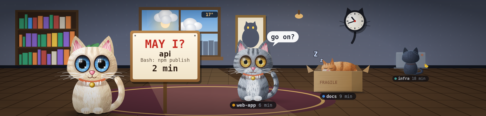

# tessera-plugin-cats

Your AI agent sessions as cats in a room: what needs you comes forward. From aimonitor.

A plugin for [Tessera](https://github.com/Loksly/tessera), the widget mosaic for small USB LCD panels.



## Install

In Tessera, **Plugins → Install from npm** → `tessera-plugin-cats`, then restart Tessera. Or from a terminal:

```sh
npm install --prefix ~/.config/tessera/plugins tessera-plugin-cats
```

(macOS: `~/Library/Application Support/Tessera/plugins`, Windows: `%APPDATA%\Tessera\plugins`.)

## Requirements

- The `agents/sessions` source from [tessera-plugin-agents](../tessera-plugin-agents) (each session is a cat).
- Optional: `weather/current` from [tessera-plugin-weather](../tessera-plugin-weather) for the sky in the window.

## Widgets

### Cats room — `cats/room`

Each AI agent session is a cat in a room with the real sky outside: the ones that need you come forward, the ones working sit at their laptops in the back.


Uses: `agents/sessions`, `weather/current`.

| Option | Type | Default | |
|---|---|---|---|
| `room` | `rotate` \| `estudio` \| `cocina` \| `cabana` \| `atico` \| `oficina` \| `japonesa` \| `acuario` \| `arcade` \| `ventanal` \| `playa` \| `espacio` \| `antartida` \| `desierto` \| `bosque` | `"rotate"` | Room. Indoors or out, each with its own window, lamp and floor. |
| `column` | `none` \| `right` \| `left` \| `alternate` | `"none"` | Strip without cats. Keeps a strip of the floor free, like the old card column. "Alternate" swaps sides now and then, against burn-in. |
| `swapSidesMs` | duration (ms) | `3600000` | Swap sides every |
| `zombieMinutes` | number | `15` | Silent session looks dead after. A working session silent for half of this turns into Schrödinger's box. |

## Interludes

### Quarter-hour duel — `cats/duel`

Two of your sessions fight it out with laser swords in the cats room. The one with fewer uncommitted files wins. With a single session, it fights the bug. Add it in Tessera → Screens → Interludes.

| Option | Type | Default | |
|---|---|---|---|
| `room` | `rotate` \| `estudio` \| `cocina` \| `cabana` \| `atico` \| `oficina` \| `japonesa` \| `acuario` \| `arcade` \| `ventanal` \| `playa` \| `espacio` \| `antartida` \| `desierto` \| `bosque` | `"rotate"` | Room. Indoors or out, each with its own window, lamp and floor. |

## Development

```sh
npm install
npm test          # node:test
npm run check     # TypeScript
npm run build     # dist/index.js, what Tessera loads
```

To try it in a running Tessera without publishing: `tessera plugins link .` and restart Tessera.

Working on Tessera and its plugins together: clone them side by side
(`tessera/` and `tessera-plugins/tessera-plugin-cats/`) and run `npm install` in
`tessera/`; its workspaces link every plugin found in `../tessera-plugins`.

## License

MIT
